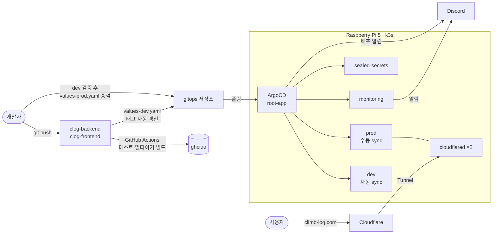

# 🏠 GitOps on Raspberry Pi 5

> 라즈베리파이 5 한 대 위의 k3s 클러스터를 ArgoCD로 운영하는 GitOps 저장소.
> 클라이밍 기록 서비스 **[Clog](https://climb-log.com)** 의 dev·prod 환경 전체(앱·DB·스토리지·모니터링·시크릿)를 이 저장소 하나로 선언합니다.

**서비스** [climb-log.com](https://climb-log.com) · **Backend** [clog-backend](https://github.com/miginho12/clog-backend) · **Frontend** [clog-frontend](https://github.com/miginho12/clog-frontend)


---

## 🎯 Overview

- **Git이 단일 진실 공급원(SSOT)**: 워크로드, 환경별 설정, 배치 작업, 알림 룰, 그리고 Secret까지(Sealed Secrets) 전부 Git에 선언합니다. 클러스터를 손으로 고치지 않습니다.
- **dev 자동, prod 수동 승격**: CI가 이미지 태그를 dev에 자동 반영하고, dev에서 검증한 **같은 이미지 태그**를 prod로 올립니다(재빌드 없음).
- **운영까지 선언**: DB 백업, 고아 파일 정리, 멈춘 작업 정리 같은 운영 배치와 Prometheus 알림 룰도 이 저장소에 있습니다.

| 항목 | 내용 |
|---|---|
| 하드웨어 | Raspberry Pi 5 8GB (ARM64), 단일 노드 |
| 클러스터 | k3s v1.35 |
| GitOps | ArgoCD v3.4 — App of Apps, Application 14개 (dev·prod·공용) |
| 외부 공개 | Cloudflare Tunnel(prod, climb-log.com) · Tailscale Funnel(dev) |
| 관측성 | kube-prometheus-stack, Loki + Promtail, AlertManager → Discord |

---

## 🏗 Architecture



**prod 네임스페이스 구성**

```
cloudflared ×2 ─▶ clog-frontend (nginx) ─┬─ /api ──────▶ clog API ×2 ──┬─ postgres-prod
                                         │                             ├─ redis-prod ── clog worker (ffmpeg)
                                         └─ /clog-media ─▶ MinIO ◀─────┘
CronJob: 고아 파일 정리(매일) · 멈춘 작업 정리(15분) · DB 백업(매일, MinIO)
```

---

## 📦 Applications

`argocd/root-app.yaml`이 `argocd/applications/`를 감시하는 **App of Apps** 구조라, 새 Application은 YAML 파일 하나만 커밋하면 자동 등록됩니다.

| Chart (`apps/`) | 내용 | dev | prod |
|---|---|---|---|
| `clog` | 백엔드 API + 트랜스코딩 워커 + CronJob 2종 + cloudflared | 자동 sync | **수동 sync** |
| `clog-frontend` | nginx(SPA + `/api`·미디어 프록시) | 자동 sync | **수동 sync** |
| `postgres` | PostgreSQL StatefulSet + 매일 백업 CronJob | 자동 | 자동 |
| `redis` | Redis StatefulSet (작업 큐, 토큰 저장) | 자동 | 자동 |
| `minio` | 객체 스토리지 (dev·prod 공용 인스턴스, 버킷·사용자 분리) | 자동 | — |
| `monitoring` | kube-prometheus-stack, Loki, Promtail, Discord 중계, 알림 룰 | 공용 | |
| `sealed-secrets` | Sealed Secrets 컨트롤러 | 공용 | |
| `nginx` | 초기 GitOps 학습용 샘플 (dev/prod 값 분리 실습) | 자동 | 자동 |

prod 앱만 수동 sync로 둔 이유: 사용자가 있는 환경이라 배포 시점을 사람이 정하고, 마이그레이션 적용 순서를 통제하기 위해서입니다. 인프라(DB·Redis)는 이미지 변경이 드물어 자동으로 둡니다.

---

## 🚀 배포 흐름

```
1. 코드 push (clog-backend / clog-frontend)
2. GitHub Actions: 린트·타입체크·보안 감사·테스트 → amd64+arm64 이미지 → ghcr.io (sha-<커밋> 태그)
3. CI가 이 저장소의 apps/<앱>/values-dev.yaml 태그를 자동 커밋
4. ArgoCD가 dev에 자동 반영 → dev에서 검증
5. 같은 sha 태그를 values-prod.yaml에 커밋 (재빌드 없이 승격)
6. ArgoCD에서 prod 수동 sync → 배포 결과 Discord 알림
```

- **환경 차이는 values 파일로만**: 같은 Chart에 `values.yaml`(공통) + `values-dev.yaml` / `values-prod.yaml`(환경별)을 겹쳐 씁니다. prod는 API replica 2, 워커 CPU·메모리 한도 상향, `readOnlyRootFilesystem` 등이 다릅니다.
- **롤백은 `git revert`**: 이력이 Git에 남고 ArgoCD가 그대로 적용합니다.
- **CI 커밋과 충돌 방지**: CI가 태그 커밋을 자주 올려 사람의 push가 거부되는 문제를 [`scripts/safe-push.sh`](scripts/safe-push.sh)로 해결했습니다. 거부되면 `pull --rebase` 후 최대 5회 재시도하고, 진짜 충돌이면 `rebase --abort`로 되돌린 뒤 사람에게 넘깁니다.

---

## 🔐 Secret 관리 — Sealed Secrets

DB 비밀번호, JWT 키, 카카오·SMTP 자격증명, Cloudflare Tunnel 토큰을 모두 **암호화된 `SealedSecret`으로 Git에 커밋**합니다. 클러스터 안의 컨트롤러만 복호화할 수 있어, 저장소가 공개돼 있어도 평문은 노출되지 않습니다.

```bash
kubectl create secret generic <name> -n <ns> --from-literal=KEY=value --dry-run=client -o yaml \
  | kubeseal --controller-namespace sealed-secrets --controller-name sealed-secrets-controller --format yaml \
  > apps/<chart>/templates/sealed-secret-<name>.yaml
```

dev와 prod는 **서로 다른 키·비밀번호**를 씁니다. MinIO도 root 계정 대신 버킷 단위 권한만 가진 전용 사용자(`clog-dev` / `clog-prod`)로 접근합니다.

---

## 📈 관측성과 알림

**Prometheus 알림 룰 8개** — [`apps/monitoring/templates/prometheus-rules.yaml`](apps/monitoring/templates/prometheus-rules.yaml)

| 대상 | 룰 |
|---|---|
| 노드 | 디스크·메모리·CPU 사용률 |
| 서비스 | 5xx 에러율(critical), 응답 지연, rate limit 급증 |
| 워커 | OOMKilled 감지(critical), 메모리 한도 90% 사전 경고 |

- AlertManager 알림은 Discord 중계를 거쳐 **인프라 채널 / 서비스 채널로 분리** 전송
- ArgoCD Notifications: 배포 성공 · Sync 실패 · Health Degraded 3종
- 앱 로그는 JSON으로 출력 → Promtail → Loki → Grafana에서 조회

---

## ⏰ 운영 배치 (CronJob)

| 작업 | 주기 | 내용 |
|---|---|---|
| 고아 미디어 정리 | 매일 03:00 / 03:30 KST (dev / prod) | DB에서 참조하지 않는 스토리지 파일 삭제 (2일 유예, 24시간 가드) |
| 멈춘 작업 정리 | 15분 | `processing`으로 60분 넘게 멈춘 영상을 `failed` 처리 + 사용자 알림 |
| DB 백업 | 매일 03:00 KST | `pg_dump` → gzip → MinIO 백업 버킷, 7일 보관 |

모든 CronJob은 `concurrencyPolicy: Forbid`(중복 실행 금지)와 실행 시간 상한을 둡니다. 정리 배치는 dry-run으로 먼저 운영해 오탐이 없음을 확인한 뒤 실제 삭제로 전환했습니다.

---

## 📁 Repository Structure

```
gitops/
├── apps/                          # 무엇을 배포하는가 (Helm Charts)
│   ├── clog/                      # 백엔드 API·워커·CronJob·cloudflared
│   │   ├── templates/
│   │   ├── values.yaml            # 공통
│   │   ├── values-dev.yaml        # dev (CI가 이미지 태그 자동 갱신)
│   │   └── values-prod.yaml       # prod (검증된 태그를 사람이 승격)
│   ├── clog-frontend/
│   ├── postgres/  redis/  minio/
│   ├── monitoring/                # kube-prometheus-stack + Loki + 알림 룰
│   ├── sealed-secrets/
│   └── nginx/                     # 초기 학습용 샘플
├── argocd/                        # 어떻게 배포하는가
│   ├── root-app.yaml              # App of Apps 루트
│   ├── applications/              # Application 선언 (앱 × 환경)
│   └── notifications-cm.yaml      # Discord 배포 알림
└── scripts/safe-push.sh           # CI 커밋과의 push 충돌 자동 재시도
```

---

## 🔍 Troubleshooting

**1. 워커 OOM — 실패 처리 코드조차 실행되지 못한 장애**
영상이 `processing` 상태로 멈췄습니다. 호스트 커널 로그(`dmesg`)까지 추적해 보니 ffmpeg가 메모리 한도(384Mi)를 넘었고, cgroup v2의 `memory.oom.group` 때문에 ffmpeg만이 아니라 **워커 프로세스 전체가 함께 종료**됐습니다. 이 저장소에서 워커 한도를 1Gi로 올려 이미지 재빌드 없이 dev·prod에 반영했고, 재발 대비로 워커 OOMKilled·메모리 90% 알림 룰과 멈춘 작업 정리 CronJob을 추가했습니다.

**2. 영상 업로드 413 — nginx location 매칭** (clog-frontend의 nginx 설정)
prod 버킷(`clog-media-prod`)이 prefix location `/clog-media/`에 매칭되지 않아(다음 글자가 `-`) SPA용 location으로 빠졌고, 그곳엔 업로드 크기 설정이 없어 nginx 기본값 1MB에 걸렸습니다. 정규식 location(`~ ^/clog-media`)으로 바꿔 해결했습니다.

**3. 클러스터 안 배치의 인증서 오류**
CronJob이 외부 공개 주소로 MinIO에 접근해 TLS 오류가 났습니다. 사용자에게 주는 presigned URL용 주소와 클러스터 내부 작업용 주소를 분리해 해결했습니다.

**4. ApplicationSet CRD annotation 크기 초과**
`kubectl.kubernetes.io/last-applied-configuration` 어노테이션이 262144바이트 제한을 넘어 apply가 실패했습니다. `kubectl apply --server-side`로 전환해 해결했습니다.

**5. Application 삭제 후 리소스 잔존**
`resources-finalizer.argocd.argoproj.io` finalizer가 없으면 Application을 지워도 Deployment·Service가 남습니다. 모든 Application에 finalizer를 추가했습니다.

**6. argocd-server CrashLoopBackOff — 시간대 표기**
admin 비밀번호 변경 시 `passwordMtime`에 `date +%Z`(KST 같은 약어) 형식을 넣은 것이 원인이었습니다. Go의 `time.Parse`는 모호한 시간대 약어를 거부하므로 `date -u +%FT%TZ`(RFC3339 UTC)로 바꿔 해결했습니다.

---

## 📄 License

[MIT](LICENSE)
